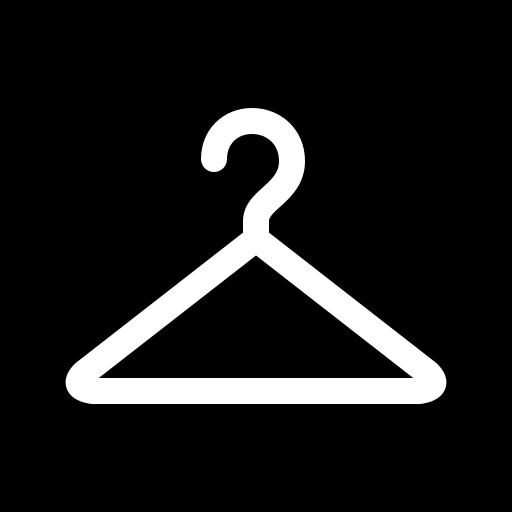

# Vestis

Save clothes from any online shop with a right-click, then see them on photos of yourself. Pick a photo, one item per section, a model, press **Try on**, and the result appears next to your original with a before/after slider.

Saw an outfit you like on someone? The **Extract** tab turns a photo of a dressed person into separate product photos of each item, ready to try on.

Generation spends your **Higgsfield subscription credits**, through a background Claude Code that writes the prompt for the chosen model. There is no prompt review: one click does everything.

## Install (Windows and macOS)

Vestis runs on your own computer: a small local server, a Chrome window and a Chrome extension. Setup takes about 15 minutes, once.

### What you need

- **Google Chrome.**
- A **Claude** account with a **Pro or Max** plan ([claude.ai](https://claude.ai)). Claude writes the image prompts in the background.
- A **Higgsfield** account with credits ([higgsfield.ai](https://higgsfield.ai)). Every try-on spends Higgsfield credits.

### 1. Install Node.js and Git (once)

| | macOS | Windows |
|---|---|---|
| **Node.js 22 or newer** | [nodejs.org](https://nodejs.org) → the **LTS** installer | [nodejs.org](https://nodejs.org) → the **LTS** installer |
| **Git** | Nothing to download: step 2 offers to install it | [git-scm.com/download/win](https://git-scm.com/download/win) → keep every default |

### 2. Download Vestis

Open a terminal (macOS: Cmd + Space, type **Terminal** · Windows: Windows key, type **PowerShell**) and run these, one at a time. The first downloads Vestis into your home folder; on a Mac it may first offer to install Git: accept, wait, then run it again.

```bash
git clone https://github.com/jcamatta/vestis.git
```

```bash
cd vestis
```

Keep the `vestis` folder where it is: the desktop icon points to it.

### 3. Run the setup

```bash
npm run setup
```

It goes through 6 steps and stops when you need to do something:

| Step | What you do |
|---|---|
| 3 · Sign in to Claude | A browser page opens: sign in to Claude and approve. |
| 4 · Higgsfield | Press Enter. Claude opens in the terminal: type `/mcp` and press Enter, pick **higgsfield** → **Authenticate**, sign in to Higgsfield in the browser and approve. Back in the terminal, press Esc, type `/exit` and press Enter. |

Everything else is automatic: it installs Claude Code if it is missing, installs and builds Vestis, and creates the **Vestis** icon:

- **Windows:** on the Desktop and in the Start menu.
- **macOS:** `Vestis.app` in the `Applications` folder of your home folder (so it shows up in Spotlight and Launchpad) and a link on the Desktop. Drag it to the Dock if you like.

If a step fails, run `npm run setup` again: it skips what is already done.

### 4. Add the Chrome extension

1. In Chrome, open `chrome://extensions`.
2. Turn on **Developer mode** (top right).
3. Click **Load unpacked** and pick the `extension` folder inside `vestis` (the setup opened it and printed its path).
4. Click the puzzle icon in Chrome's toolbar and pin **Vestis**.

### 5. Open it

Double-click the **Vestis** icon. Each time it gets the latest version from GitHub (offline, it uses the one you have), builds it (the first time takes a minute, later a few seconds), starts Vestis in the background and opens it in its own Chrome window. On Windows a minimized window shows the progress; on macOS a notification.

Closing the window doesn't stop Vestis, so opening it again is instant and you can keep adding items from shops. Restarting the computer stops it, or run `npm run stop` in the `vestis` folder. With Vestis running, the Vestis button in Chrome's toolbar also opens it.

Each **Try on** and each **Extract** uses Higgsfield credits. Adding photos and items doesn't.

### Troubleshooting

| Problem | Fix |
|---|---|
| A black bar at the top of Vestis | It says what is wrong: Claude signed out, or Higgsfield not connected or not answering. Try on and Extract stay off until it is fixed. Usually: run `npm run setup` again in the `vestis` folder, then press **Check again**. Vestis also checks every few minutes and after any failed run. |
| "Vestis is not running" when you right-click in a shop | Open Vestis with its icon. |
| A look shows an error under the photo | It says what failed, for example no Higgsfield credits left. Fix that and press **Try on** again. |
| "Blocked by Higgsfield's safety filter" | FLUX 3 blocks some brands (Nike, Jordan). Pick GPT Image 2.5 at the top left and try again. |
| The icon does nothing | macOS: open `data/logs/launch.log` in the `vestis` folder. Windows: the minimized window in the taskbar shows the error. Vestis itself logs to `data/logs/server.log`. |
| The icon stopped working after moving the folder, or after installing Node again | Run `npm run shortcut` in the `vestis` folder. |
| "Could not update from GitHub" | You are offline; Vestis opens with the version you have. |
| `node`, `npm` or `git` "not recognized" / "command not found" | Install it (step 1), then open a **new** terminal. In a new terminal, `cd vestis` first. |

### Where your things are

Your photos, items and looks stay on your computer, in the `data` folder inside `vestis`: `wardrobe.json` lists them, `media/` holds the images (`people`, `garments`, `looks`, plus `canvases`, `outfits` and `extractions` used while working). Updates never touch `data`, and it never goes to GitHub. Higgsfield also keeps a copy of each upload and result in your Higgsfield library.

## How it works

```
Chrome extension                        local app (127.0.0.1)
────────────────                        ─────────────────────
right-click a product photo             web page (React)  ⇄  server (Node)
→ "Add to Vestis" → section                                     │
→ image bytes + page title ───────────────────────────────────► │ saves the image (JPEG, white background)
                                                                │ background Claude reads it: section, name, description
                                                                │
you press Try on ──────────────────────────────────────────────►│ puts the garments on one canvas image
                                                                │ background Claude:
                                                                │   reads the model's prompt skill → writes the prompt
                                                                │   uploads your photo + the canvas to Higgsfield
                                                                │   starts the generation, waits, returns the result URL
                                                                │ downloads the result → the page updates live
```

- **Background Claude** = `claude -p` (the Claude Code CLI, on your Claude subscription) with the Higgsfield MCP added to the CLI. No API keys anywhere. Only the server starts it, one look at a time.
- **Sections:** Head (hats), Glasses, Tops, Pants, Shoes. One item per section per look, up to 5. When a photo is added, Claude decides which sections it can show: no feet visible → no Shoes.
- **Models** (pick at the top left): GPT Image 2.5 (default), FLUX 3, Ideogram 4.5. Each has its own prompt skill in `skills/`. Every look shows which model made it.
- **While generating**, the label under the photo shows the real step: writing the prompt, uploading, Higgsfield is generating, downloading.
- **Setup check:** the server checks `claude auth status` and `claude mcp get higgsfield` at start, every five minutes, and after any failed Claude run. When something is wrong, a bar under the header says what and how to fix it (Check again re-runs it), and Try on and Extract are off. `GET /api/setup` reads the last check, `POST /api/setup/check` checks now.

## Use in detail

1. **Add a photo of yourself**: the `+` at the top left of the stage, or drop the photo on the stage. JPEG, PNG, WebP or AVIF. Claude reads it (about 20 s) and decides which sections it can show.
2. **In a shop**, right-click the product photo → **Add to Vestis** → pick the section, or let Claude decide. A toast confirms it, and the item appears in the app with a name and description written by Claude. A photo of the product alone works best; a photo of a model wearing it also works.
3. **Wrong section?** Hover the item → **Move** → pick the right one. **Remove** deletes it.
4. **In the app**, pick one item per section, a fit if you want one (Tops, Pants), and press **Try on**. It takes 1–4 minutes. Without a fit, the item keeps the fit shown in the shop photo.
5. **Results**: each look appears in the strip under the photo, labelled with its model. Click it to see it with the before/after slider; **Result only** hides the slider. Hover a look for its **×** to delete it.
6. **Looks** tab: every result. Pick one to compare it with your photo, or two to compare them with each other.
7. **Extract** tab: add a photo of someone wearing an outfit (`+`, drop it, or in a shop right-click the photo → **Extract outfit (Vestis)**). Claude lists what they wear (about 20 s, free). Untick what you don't want and press **Extract**: one GPT Image 2.5 generation draws every ticked item as a product photo on one sheet, and the app cuts them apart into your sections, marked "from photo". **Try these on** takes you to Try on with them picked (one per section).
8. **Where to buy** (Extract tab, after extracting): each item has a **Lens** button; **Find where to buy: all items** does them all. The extension opens a Google Lens tab per cut-out in your Chrome and reads the products Lens shows. When Lens found something, the button turns into **N found**: hover or click it for up to 5 products (title, shop, price, link) and **Search again**. Nothing found leaves the plain Lens button. At the top of the items, a rough total in one currency (no conversion). Free, no Claude run, no credits. The Lens tabs stay open to browse more. Needs the extension 0.3: reload it in `chrome://extensions` after updating. If Google changes the Lens page, the reader may find nothing; the tabs still open.

Good to know:
- **FLUX 3 blocks Jordan and Nike items** ("Blocked by Higgsfield's safety filter"). Use Ideogram 4.5 or GPT Image 2.5 for those.
- A blocked look is not retried. The same outfit on the same photo can't be queued twice.
- Looks and extractions share one queue: one Higgsfield job at a time.
- Deleting a look that is still waiting cancels it. One already generating finishes on Higgsfield (credits spent); only the result is discarded.

## Development

```bash
npm run dev
```

Open http://127.0.0.1:5174 (hot reload), or click the extension's button: it opens the dev server when it runs, else the built app on 3100. After any change to the extension, click its reload arrow in `chrome://extensions`, then reload the shop tabs.

| Command | What |
|---|---|
| `npm run setup` | One-time setup: Claude Code, sign-in, Higgsfield, install, build, icon |
| `npm run app` | What the icon does: `git pull`, install what changed, build, (re)start the server in the background on 3100 (not while a job runs), open a Chrome app window |
| `npm run stop` | Stop the background server |
| `npm run shortcut` | Recreate the icon for this folder (`scripts/vestis.png` / `.ico`, drawn from `scripts/vestis.svg`) |
| `npm run dev` | Server (`tsx watch`) + Vite, with hot reload |

By hand, the setup is: `claude` → `/login`; `claude mcp add --transport http --scope user higgsfield https://mcp.higgsfield.ai/mcp`, then `claude` → `/mcp` → higgsfield → Authenticate; `npm install` in the root, `server/` and `web/`.

## Tech

| Part | Stack |
|---|---|
| `server/` | Node 24, TypeScript, Express 5, sharp (images), zod (validation). Run with `tsx watch`. |
| `web/` | Vite, React 19, TypeScript, Tailwind CSS 4, Base UI (all controls), Geist and Geist Mono fonts. |
| `extension/` | Chrome Manifest V3, plain JavaScript, no build step. |
| Generation | Claude Code CLI (`claude -p`, model Sonnet) + Higgsfield MCP. |
| Data | One JSON file and image files on disk. No database. |

Ports: server `3100`, web `5174` (Vite proxies `/api` to the server). Both listen only on `127.0.0.1`, and the server refuses requests whose Host is not local.

## Code

Functional style: data types, pure functions and side effects live in separate folders; every function takes one typed argument. The web app goes controller → view → components.

```
vestis/
├── extension/            background.js (right-click menus Add to Vestis / Extract outfit, fetches the image, posts it; opens the Lens tabs) · content.js (finds the image under the pointer; passes the app's Lens request on; reads Lens results) · lens.html/lens.js (sends a cut-out to Google Lens)
├── scripts/            setup.mjs (npm run setup) · launch.mjs (the icon: update, build, start, open; --stop) · create-shortcut.mjs · common.mjs · vestis.svg/png/ico
├── skills/               one prompt skill per model: flux_3_image.md · gpt_image_2_5.md · ideogram_4_5.md · extract_gpt_image_2_5.md (Extract)
├── server/src/
│   ├── data/             types and constants: slots, models (models.ts), wardrobe, zod schemas
│   ├── pure/             no side effects: Claude task prompts (tasks.ts), canvas layout, extract grid and crop boxes, shopping total, aspect ratio, output parsing, wardrobe updates
│   ├── actions/          side effects: run Claude (claude.ts), queues, try-on jobs (jobs.ts), extraction jobs (extract.ts), Lens results (shop.ts), images (sharp), store, live events
│   ├── http/             Express routes: /api/garments, /api/people, /api/looks, /api/extractions, /api/wardrobe, /api/events, /api/files
│   └── main.ts
└── web/src/
    ├── data/             types and constants
    ├── pure/             no side effects: wardrobe helpers, split-view math
    ├── actions/          API calls, live updates (server-sent events), file picker
    ├── controllers/      hooks holding state: use-app-controller, use-try-on, use-extract, use-looks, use-wardrobe; split view
    ├── views/            the three tabs: try-on-view, extract-view, looks-view
    └── components/       cards, strips, menus, buttons
```

**Image handling:** every input is re-encoded to JPEG, with EXIF rotation applied and transparency flattened on white. Photos are kept up to 4 MP, items up to 2 MP. The items of a look are merged into one canvas (2 MP–3.4 MP). The output aspect ratio is the one the model supports that is closest to your photo.

**Adding a model:** add an entry to `server/src/data/models.ts` (Higgsfield id, aspect ratios, parameters) and write `skills/<model id>.md`. Check the model on Higgsfield first; its limits change.

## Settings

Environment variables for the server:

| Variable | Default | What |
|---|---|---|
| `VESTIS_HF_TOOLS_PREFIX` | `mcp__higgsfield__` | Tool-name prefix of the Higgsfield MCP in the CLI. Change it if the MCP was added under another name. |
| `VESTIS_CLAUDE_MODEL` | `sonnet` | Claude model for the background runs |
| `VESTIS_CLAUDE_BIN` | `claude` | Path to the Claude Code executable |

## More

`PLAN.md` holds the decisions, the status and what was verified.
